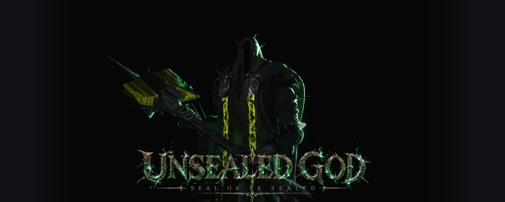
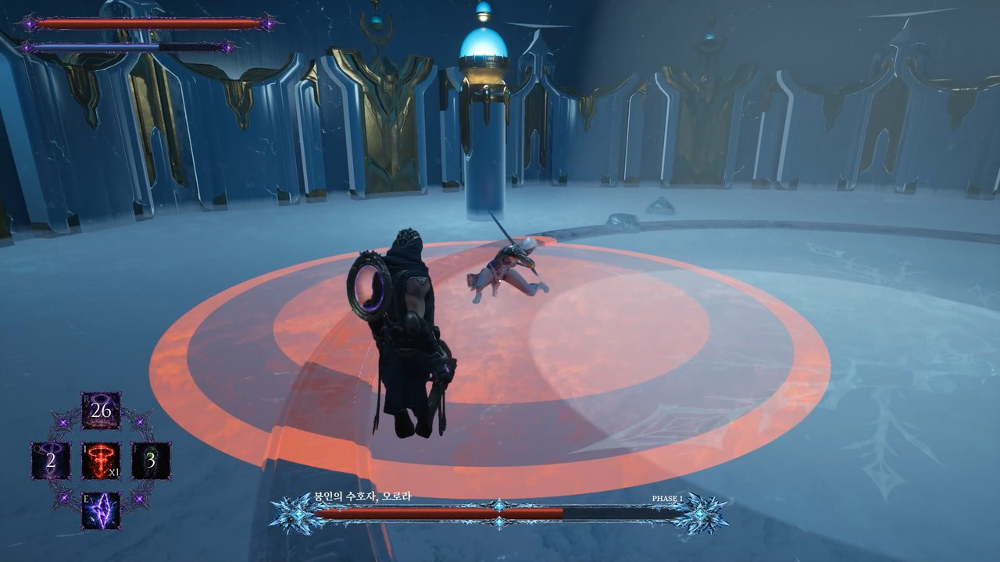
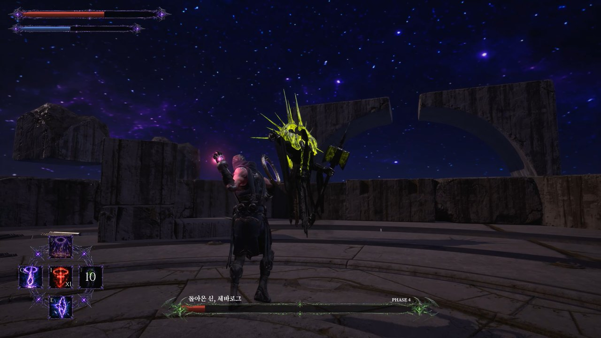
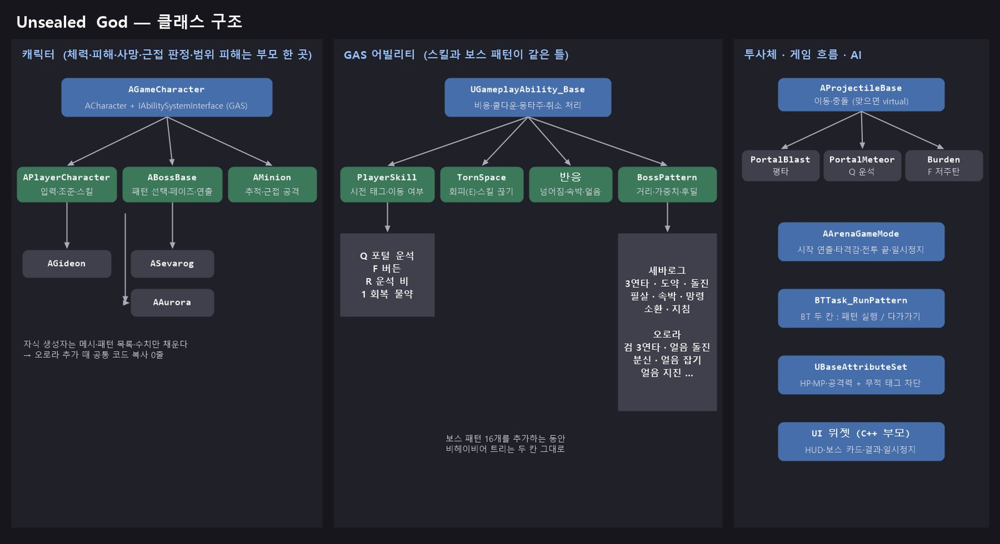
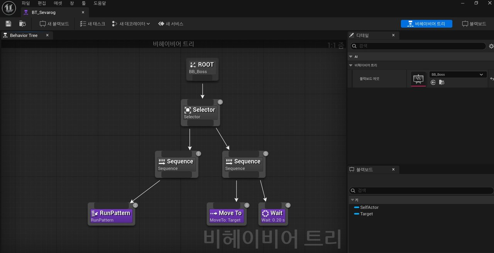
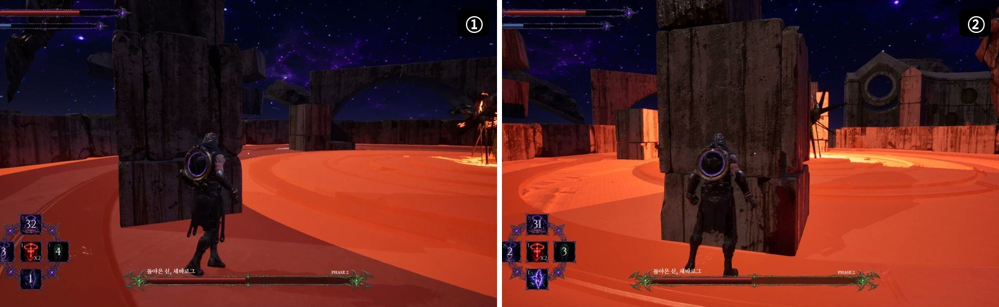

# Unsealed God



봉인에서 풀려난 신들과 차례로 싸우는 **3인칭 보스 러시 액션**입니다.
Unreal Engine 5 · C++ · GAS로 만든 1인 개발 포트폴리오입니다.

[](https://www.youtube.com/watch?v=JS7BVevjB5A)

▶ **[전체 플레이 영상 (7분 23초)](https://www.youtube.com/watch?v=JS7BVevjB5A)** · 📄 **[기술문서 (PPT)](docs/UnsealedGod_TechDoc.pptx)** · 📝 **[개발 일지 (DEVLOG)](DEVLOG.md)**

---

## 개요

| | |
|---|---|
| 장르 | 3인칭 보스 러시 액션 (소울류 패턴 학습) |
| 기간 | 2026.10.12 ~ 11.06 (4주) |
| 인원 | 1인 개발 — 기획 · 프로그래밍 · 레벨 아트 · UI |
| 엔진 | Unreal Engine 5.8 · C++ · Gameplay Ability System |
| 규모 | C++ 클래스 72개 · 약 1만 9천 줄 · 보스 2체 · 보스 패턴 16개 |

## 게임 소개

| 1스테이지 — 오로라, 봉인의 수호자 | 2스테이지 — 세바로그, 돌아온 신 |
|---|---|
|  |  |
| 얼음 궁전. 검과 얼음으로 빙결시키고, HP 50%에 '얼음 여제'로 변신 | 무너진 아슈르 신전. 페이즈마다 커지고 빨라지며, 2페이즈부터 미니언을 소환 |

- **패턴 학습** : 모든 공격은 바닥에 먼저 예고된다 → 피하고 → 후딜에 반격
- **거리 싸움** : 원거리 마법사 기디언 vs 거리를 좁혀 오는 근접 보스 (도약 · 돌진 · 잡기)
- **기둥 엄폐 필살기** : HP 75 · 50 · 25%마다, 기둥 뒤에 숨지 않으면 즉사

### 조작

| 입력 | 스킬 | 역할 |
|---|---|---|
| WASD · 마우스 | 이동 · 시점 (화면 중앙 조준) | |
| 좌클릭 | 포털 블라스트 | 이동하며 연사, 3타째 강화 |
| E | 토른 스페이스 | 순간이동 회피, 짧은 무적 |
| Q | 포털 운석 | 하늘에서 운석 낙하, 범위 폭발 |
| F | 버든 | 저주탄 — 걸어 두는 지속 피해 |
| R | 운석 비 | 장판 궁극기, 시전 중 회피 불가 |
| 1 | 회복 링 | 페이즈마다 +1회, 끊으면 회복한 만큼만 |

---

## 핵심 시스템



### 1. 스킬과 보스 패턴을 같은 GAS 구조로
기디언 스킬과 보스 패턴 16개가 모두 `GameplayAbility`입니다. 시작 · 끝 · 중단 · 쿨다운을 한 틀로 처리하고, 타이밍은 **애님 노티파이 → 게임플레이 이벤트 → 어빌리티 태스크**로 받습니다. 스킬 · 패턴 하나 = 클래스 하나.
- [`GameplayAbility_Base`](Source/UnsealedGod/GAS/Ability/GameplayAbility_Base.cpp) — 비용 · 쿨다운 · 취소 처리 공통 부모
- [`GameplayAbility_PlayerSkill`](Source/UnsealedGod/GAS/Ability/GameplayAbility_PlayerSkill.cpp) — Q · F · R은 `virtual OnFire` 하나만 덮어쓴다
- [`GameplayAbility_BossPattern`](Source/UnsealedGod/GAS/Ability/GameplayAbility_BossPattern.cpp) — 사용 거리 · 가중치 · 후딜 · 바닥 예고

### 2. 보스 AI — 비헤이비어 트리는 두 칸, 선택은 C++


비헤이비어 트리는 "패턴 실행 / 다가가기" 두 갈래뿐입니다. [`ABossBase::SelectPattern`](Source/UnsealedGod/Boss/BossBase.cpp)이 거리 → GAS 조건(쿨다운 · 페이즈 태그) → 우선순위 → 가중치 랜덤으로 고릅니다. 패턴을 16개로 늘리는 동안 트리는 한 번도 고치지 않았고, 두 보스가 같은 트리를 씁니다.
- [`BTTask_RunPattern`](Source/UnsealedGod/Boss/AI/BTTask_RunPattern.cpp) · [`Sevarog`](Source/UnsealedGod/Boss/Sevarog.cpp) · [`Aurora`](Source/UnsealedGod/Boss/Aurora.cpp) (자식은 메시 · 패턴 목록 · 수치만 채운다)

### 3. 페이즈 성장
HP 75 · 50 · 25%에서 필살기 → `EnterPhase`가 크기 · 공격력 · 속도 · 갑옷 발광을 올리고 `Boss.Phase.N` 태그를 **누적**합니다. 패턴은 "N페이즈 이상"을 태그 하나로 적어서, 보스 코드에 `if (페이즈 >= 2)`가 늘지 않습니다. 3페이즈부터는 커진 대가로 **지치는** 구간이 생깁니다.

### 4. 기둥 엄폐 필살기 — 빛과 그림자로 보여 주는 판정


충격 순간 보스 가슴 → 기디언 몸 중심으로 라인 트레이스. 기둥에 막히면 생존, 아니면 회피 무적도 무시하고 즉사합니다. 안전지대를 따로 그리지 않고 **판정 시작점에 둔 붉은 점광원의 기둥 그림자**로 보여 줘서, 판정과 표시가 어긋날 수 없습니다.
- [`GameplayAbility_Pattern_Ultimate`](Source/UnsealedGod/GAS/Ability/GameplayAbility_Pattern_Ultimate.cpp) · [`UltimateLight`](Source/UnsealedGod/Boss/UltimateLight.cpp)

### 5. 그 밖에
| 시스템 | 설명 | 코드 |
|---|---|---|
| 투사체 | 이동 · 충돌은 부모, "맞았을 때"만 자식이 `virtual StopCallback`으로 다르게 | [`ProjectileBase`](Source/UnsealedGod/Projectile/ProjectileBase.cpp) · [`PortalMeteorProjectile`](Source/UnsealedGod/Projectile/PortalMeteorProjectile.cpp) |
| 회피로 스킬 끊기 | Q · F에 애셋 태그를 붙이고, 회피가 **발동에 성공한 뒤에만** 취소 | [`GameplayAbility_TornSpace`](Source/UnsealedGod/GAS/Ability/GameplayAbility_TornSpace.cpp) |
| 타격감 | 히트스톱 · 카메라 흔들림을 사건별 표 하나로 관리 | [`ArenaGameMode::PlayHitFeedback`](Source/UnsealedGod/GameMode/ArenaGameMode.cpp) |
| HUD | HUD가 매 프레임 값을 읽어 감(Pull). 쿨다운은 GAS 쿨다운 효과의 남은 시간 | [`PlayerHUDWidget`](Source/UnsealedGod/UI/PlayerHUDWidget.cpp) |
| 체력 · 피해 | 공용 AttributeSet + SetByCaller 피해. 무적은 태그로 차단 | [`BaseAttributeSet`](Source/UnsealedGod/GAS/BaseAttributeSet.cpp) · [`GameCharacter`](Source/UnsealedGod/Character/GameCharacter.cpp) |

## 문제 해결 (자세한 과정은 [DEVLOG](DEVLOG.md))

| 문제 | 원인 | 해결 |
|---|---|---|
| 회복 링을 E로 끊어도 회복이 끝까지 들어감 | GAS 취소 순서 : 몽타주 "중단됨" 콜백이 취소 아닌 `EndAbility`를 먼저 불러, 진짜 취소가 무시됨 | 공통 부모가 `CancelAbility`를 덮어써 취소 중 표시 → 모든 스킬 · 패턴이 한 번에 고쳐짐 |
| 보스 등장 때 망치가 손에서 하늘로 휘돎 | 숨어 있던 대기 자세와 등장 첫 자세를 섞는 몽타주 **블렌드 인** | 숨어 있다 나타날 때만 블렌드 인 0초 |
| 보스가 기둥 위에 올라감 | 이동 중 기둥을 통과 → 기둥 안에 내려앉으면 충돌이 몸을 위로 밀어냄 | 녹화를 프레임 단위로 분석 → 기둥 판정을 15m로 높여 옆으로 밀리게 |

---

## 저장소 구성

```
Source/UnsealedGod/
├── Character/   공통 부모 AGameCharacter (GAS · 체력 · 근접 판정 · 범위 피해)
├── Player/      기디언 (입력 · 조준 · 스킬 슬롯)
├── Boss/        ABossBase → Sevarog · Aurora, 패턴 실행 태스크, 예고 데칼, 필살기 빛
├── Minion/      2페이즈부터 소환되는 미니언
├── AI/          보스 · 미니언 공용 컨트롤러, 미니언 공격 태스크
├── GAS/         AttributeSet · GameplayEffect · Ability(스킬 · 보스 패턴 16개)
├── Projectile/  평타 · 운석 · 저주탄
├── Skill/       운석 비 장판
├── AnimNotify/  애니메이션 타이밍 → 게임플레이 이벤트 · 무적 · 근접 판정 구간
├── Input/       입력 액션 모음
├── GameMode/    전투 흐름 · 시작 연출 카메라 · 타격감 · 스테이지 포탈
└── UI/          HUD · 스킬 칸 · 보스 소개 · 일시정지 · 결과 화면
```

### 에셋은 포함하지 않습니다
이 저장소에는 **코드와 설정만** 있습니다. `Content/` 폴더는 라이선스 때문에 올리지 않았으므로, 받아서 바로 빌드 · 실행할 수는 없습니다.
- 캐릭터 · 환경 · 이펙트 : Epic Games의 Paragon 무료 에셋 (Fab)
- 효과음 : Sonniss GDC 무료 번들
- UI : 직접 디자인

## 연락처
- 이메일 : hj2000728@naver.com
